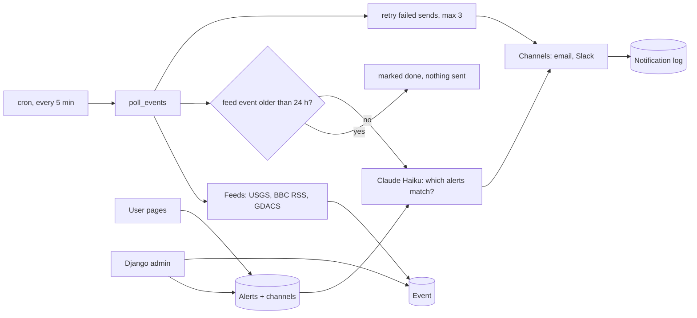
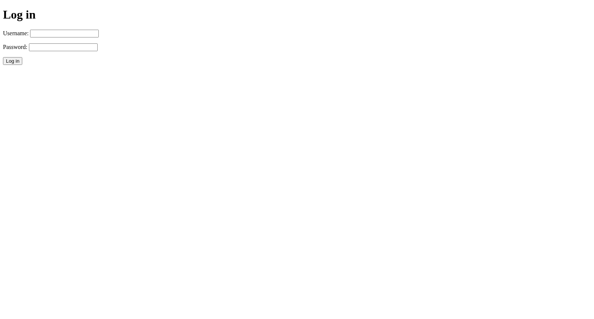
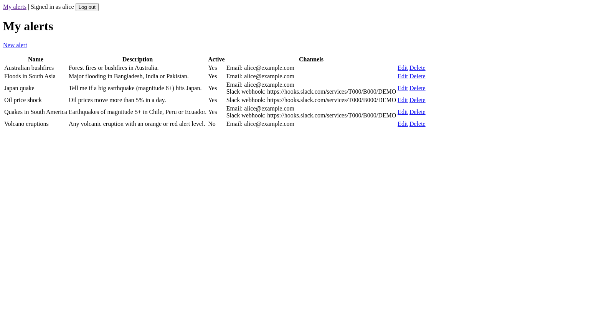
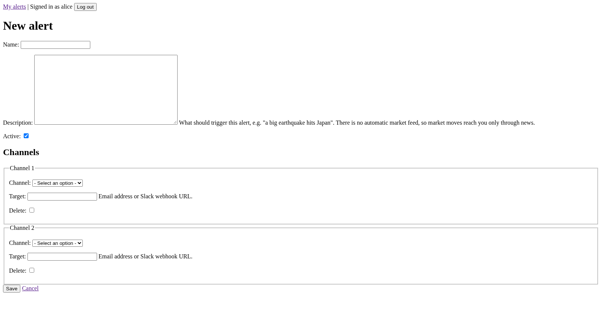
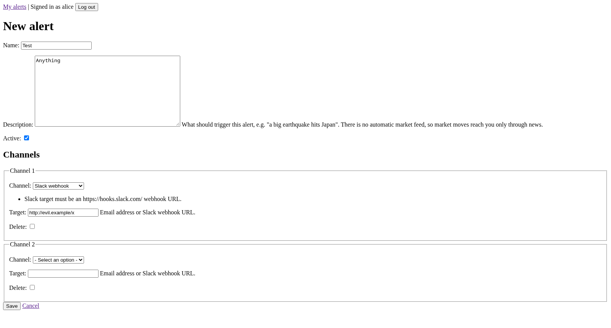
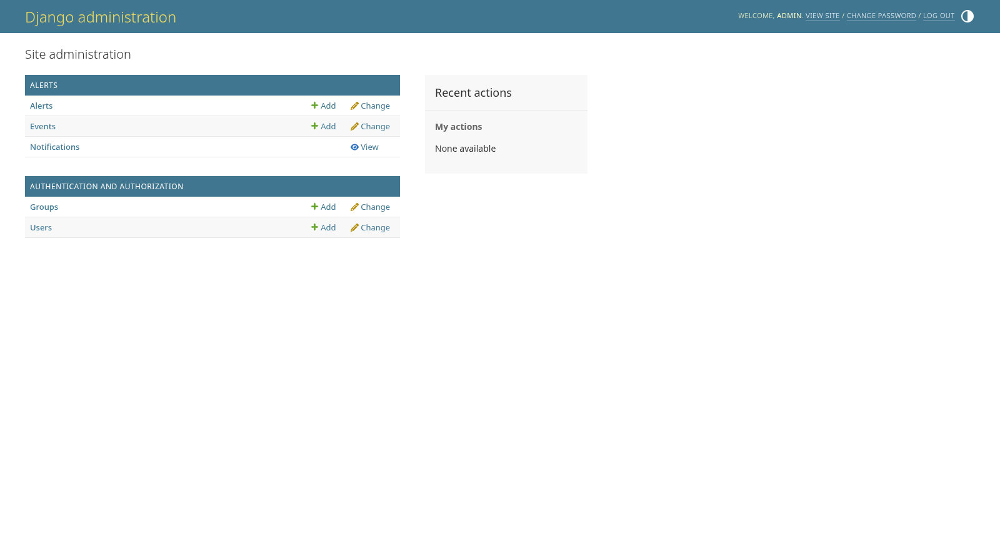
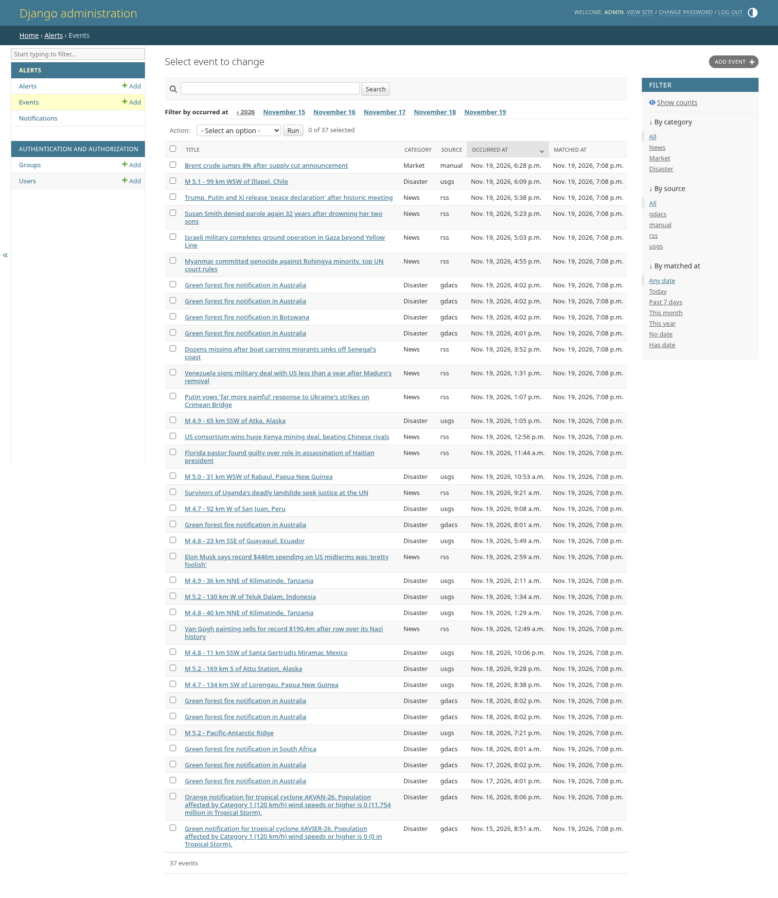
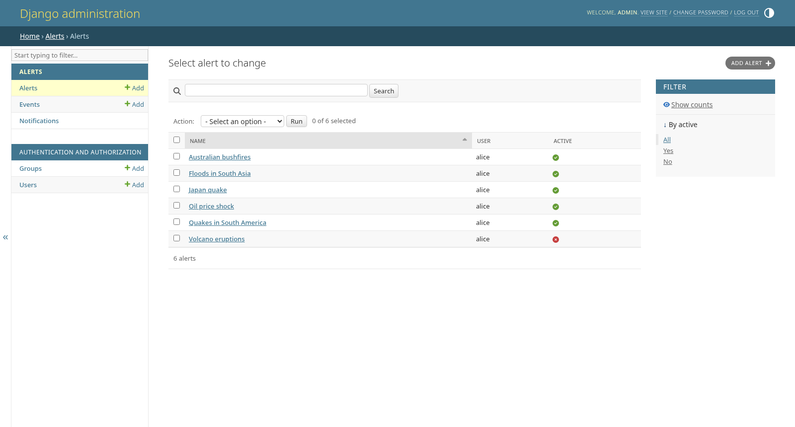
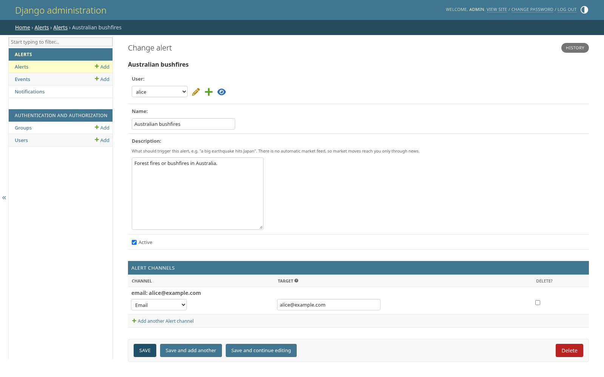

# World event alerts

Users describe what they care about in plain text ("tell me if a big quake hits Japan").
A cron job pulls events from free public feeds, Claude Haiku decides which alerts each
new event matches, and matches are delivered by email and/or Slack. Admins manage
users, alerts, events and the notification log in Django admin.

Built with Django 6.1, SQLite and the Anthropic Python SDK, managed with `uv`. MIT licensed.

## How it works



1. **Ingest.** Each source returns events; they are stored once per (source, external id).
2. **Window.** Feed events older than 24 hours are marked done without a Claude call, so a first
   deploy or an outage doesn't send old news. Events an admin adds always match.
3. **Match.** One Claude Haiku call per new event, with every active alert in the prompt and
   structured output (`alert_ids`). Ids outside the active set are ignored.
4. **Deliver.** Each matched alert's channels get a message; every send is logged as a
   `Notification` (`sent` or `failed`). The same alert channel never gets the same event twice.
5. **Retry.** Failed sends are retried on the next runs, up to 3 attempts.

## Features

- Free-text alerts: write what you care about, Claude decides what matches.
- Email (SMTP) and Slack incoming webhooks; more channels plug into one registry.
- Free public feeds, no API keys besides Claude: USGS earthquakes (M4.5+), BBC World news, GDACS
  floods, cyclones, volcanoes, droughts and wildfires. Market events are added by hand.
- Users manage only their own alerts; admins create users and see everything, including a
  read-only notification log with status, attempts and errors.
- Failure isolation: one dead feed, a failing channel or a Claude outage never stops the run.

## Status

- Feature-complete for the original request, reviewed in four BMAD review passes plus a
  whole-project review report (see [Project docs](#project-docs)).
- 54 tests, all network mocked; `manage.py check` and `makemigrations --check` clean.
- **Not yet run against the real Claude API, an SMTP server or Slack.** The screenshots below use
  real feed events but staged notifications.

## Setup

```sh
uv sync
uv run python manage.py migrate
uv run python manage.py createsuperuser
uv run python manage.py runserver
```

In production (`DJANGO_DEBUG` off) run `uv run python manage.py collectstatic` and serve
`staticfiles/` at `/static/`, or the admin has no styling.

- Admin: `/admin/` — create users here (there is no public sign-up), plus alerts, channels, manual events, and the notification log.
- Users: log in at `/accounts/login/` to manage their own alerts.

## Screenshots

Taken from a local run with real events from the live feeds (USGS, BBC, GDACS) and demo users;
the notifications shown were staged, not produced by Claude.

| | |
|---|---|
|  Login |  A user's alerts |
|  New alert form |  Non-Slack webhook URL rejected |
|  Admin home |  Events from the feeds |
|  Read-only notification log |  Alerts in admin |
|  Alert with its channels | |

## Environment variables

| Variable | Purpose | Default |
|----------|---------|---------|
| `DJANGO_SECRET_KEY` | Django secret key. **Set it in production**; without it a random key is used and sessions reset on every restart | random per process |
| `DJANGO_DEBUG` | `1` enables debug | off |
| `DJANGO_ALLOWED_HOSTS` | Comma-separated hosts | `localhost,127.0.0.1` |
| `DJANGO_CSRF_TRUSTED_ORIGINS` | Comma-separated origins, e.g. `https://alerts.example.com`. Needed behind an HTTPS proxy, or logins and forms fail the CSRF check | empty |
| `EMAIL_HOST` | SMTP host; when unset, emails are printed to the console | unset |
| `EMAIL_PORT` | SMTP port | `587` |
| `EMAIL_HOST_USER` / `EMAIL_HOST_PASSWORD` | SMTP credentials | empty |
| `EMAIL_USE_TLS` | `1` or `true` for STARTTLS | `1` |
| `DEFAULT_FROM_EMAIL` | Sender address | `alerts@localhost` |
| `ANTHROPIC_API_KEY` | Claude API key (read by the `anthropic` SDK) | — |

Feed and matching settings live in `config/settings.py`: `EVENT_RSS_FEEDS`, `ALERT_MATCH_MODEL`.

## Sources

- `usgs`: USGS earthquakes of magnitude 4.5+ from the last day (category `disaster`).
- `rss`: each feed in `EVENT_RSS_FEEDS`, BBC World by default (category `news`). One failing feed doesn't skip the others.
- `gdacs`: GDACS global disaster alerts — floods, cyclones, volcanoes, droughts, wildfires (category `disaster`).
  GDACS earthquakes are skipped because USGS already covers them.

There is no market feed. Market events (category `market`) are added by hand in admin
(`/admin/alerts/event/add/`). Use any source name that isn't a feed key (e.g. `manual`) and an external id that is unique for that source. Admin-added events are matched and delivered on the next poll run, whatever their date.

## Polling

Run the poller from cron every 5 minutes. Cron doesn't load your shell environment, so put the
variables above in a wrapper script or in the crontab itself, and keep a log:

```
*/5 * * * * cd <dir> && flock -n ~/poll_events.lock uv run python manage.py poll_events >> ~/poll_events.log 2>&1
```

`flock -n` skips a run while the previous one is still going (a slow Claude call can take
minutes), so two runs never overlap. A crash between sending a notification and recording it
can still send it again on the next run.

Each run fetches every source, stores new events (deduplicated by source + external id),
asks Claude once per unmatched event which active alerts it satisfies, sends to each matched
alert's channels and records a `Notification` per channel. Only feed events from the last 24
hours are matched and sent; older ones are marked done without a Claude call or a notification,
so a first deploy or an outage doesn't send old news. If a Claude call fails with any API error,
the event stays unmatched and is retried on the next run. After 3 failed calls in a row, a run
stops matching and the rest waits for the next run. A failing source or channel is logged and
does not stop the run.

Failed sends are retried automatically: each run re-sends every `failed` notification from an
earlier run in the last 24 hours, up to 3 attempts in total (`attempts` column in the admin notification log).
After the third failure it stays `failed`.

The first run after setup stores everything currently in the feeds. Only the recent events get a
Claude call; the rest are marked done.

## Adding a channel

In `alerts/channels.py`, write a `send(target, subject, body)` function and a
`validate(target)` function that raises `ValidationError`, then add one entry:

```python
CHANNELS["teams"] = Channel("Microsoft Teams", validate_teams, send_teams)
```

The channel appears in the alert form and admin. Run `uv run python manage.py makemigrations`
once to record the new choice (no schema change).

## Adding a source

In `alerts/sources.py`, write a function that returns a list of dicts with the `Event` fields
`external_id`, `category` (`news`, `market` or `disaster`), `title`, `summary`, `url`,
`occurred_at`, and add it to `SOURCES` under a unique key.

## Tests

```sh
uv run python manage.py test alerts
```

All network access (Claude, feeds, Slack) is mocked.

## Security notes

- Feed text and alert descriptions are untrusted: the prompt says so and both are XML-escaped,
  so one user's alert can't forge another's.
- Slack targets must start with `https://hooks.slack.com/`. This is checked when the alert is
  saved and again before every send, and redirects are refused, so the server can't be made to
  POST elsewhere.
- Slack text escapes `& < >`, so feed text can't ping `@channel` or disguise links. Email
  subjects have newlines removed.
- Alert descriptions are capped at 2000 characters; feed summaries are stripped of HTML and capped.
- Without `DJANGO_SECRET_KEY` a random key is used (never a public default). Set it in production.
- Not set by default: secure cookies, HSTS and HTTPS redirect (they break plain-HTTP setups); a
  feed size cap and `defusedxml` (the feeds are fixed, well-known publishers).

## Known limits

- All active alerts go into one prompt; batch them beyond a few hundred alerts.
- A crash between sending and recording a notification can send it again on the next run.
- An admin event that Claude always rejects costs one failed call per run.
- Updates to known events (a GDACS alert escalating, a USGS magnitude revision) are not re-checked.
- The same target can be added twice to one alert and then gets two messages.
- The user pages are plain, unstyled HTML.

## Project docs

| Doc | What it holds |
|-----|---------------|
| [docs/PLAN.md](docs/PLAN.md) | Goal, scope, work items, acceptance criteria, edge-case matrix with tests, open items |
| [docs/DECISIONS.md](docs/DECISIONS.md) | Every decision: options offered, choice, who decided, superseded and rejected ones |
| [docs/CODEBASE_MAP.md](docs/CODEBASE_MAP.md) | Architecture, file-by-file guide, data flow, gotchas, where to change what |
| [reports/review/](reports/review/2026-11-19-world-event-alerts-the-whole-project/index.html) | Whole-project review report (download and open `index.html` in a browser) |
| [Spec](_bmad-output/implementation-artifacts/spec-world-event-alerts.md) | BMAD spec: intent, constraints, change log, all review triage logs |
| [docs/PROMPTS.md](docs/PROMPTS.md) | Every prompt, question and answer, and model change during the build |
| [docs/VALIDATION-LOG.md](docs/VALIDATION-LOG.md) | Claude's reports worth checking, each with the prompt that followed |

## How this was built

The app was built with Claude Code and the [BMAD Method](https://github.com/bmad-code-org/BMAD-METHOD)
(`bmad-build-auto`):
- A spec was written from the request, with product questions asked interactively.
- An implementation subagent built the app, then four parallel reviewers checked it (blind hunter,
  edge-case hunter, verification gap, intent alignment) and the findings were triaged and patched.
- This ran for four review passes, until a pass found nothing high-severity.

The BMAD framework itself (`_bmad/`, `.claude/`) is not committed. Install it with `npx bmad-method install`.

## License

[MIT](LICENSE) © 2026 KPharcos
