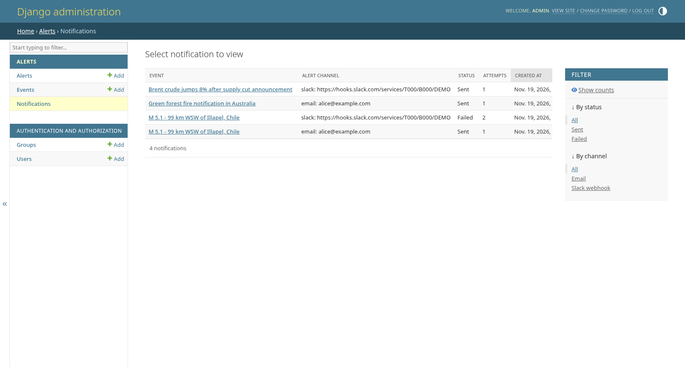

# World event alerts

Users describe what they care about in plain text ("tell me if a big quake hits Japan").
A cron job pulls events from free public feeds, Claude Haiku decides which alerts each
new event matches, and matches are delivered by email and/or Slack. Admins manage
users, alerts, events and the notification log in Django admin.

## Setup

```sh
uv sync
uv run python manage.py migrate
uv run python manage.py createsuperuser
uv run python manage.py runserver
```

In production (`DJANGO_DEBUG` off) run `uv run python manage.py collectstatic` and serve
`staticfiles/` at `/static/`, or the admin has no styling.

- Admin: `/admin/` — create users here (there is no public sign-up), plus alerts, channels, manual events, and the notification log.
- Users: log in at `/accounts/login/` to manage their own alerts.

## Screenshots

Taken from a local run with real events from the live feeds (USGS, BBC, GDACS) and demo users;
the notifications shown were staged, not produced by Claude.

| | |
|---|---|
|  Login |  A user's alerts |
|  New alert form |  Non-Slack webhook URL rejected |
|  Admin home |  Events from the feeds |
|  Read-only notification log |  Alerts in admin |
|  Alert with its channels | |

## Environment variables

| Variable | Purpose | Default |
|----------|---------|---------|
| `DJANGO_SECRET_KEY` | Django secret key. **Set it in production**; without it a random key is used and sessions reset on every restart | random per process |
| `DJANGO_DEBUG` | `1` enables debug | off |
| `DJANGO_ALLOWED_HOSTS` | Comma-separated hosts | `localhost,127.0.0.1` |
| `DJANGO_CSRF_TRUSTED_ORIGINS` | Comma-separated origins, e.g. `https://alerts.example.com`. Needed behind an HTTPS proxy, or logins and forms fail the CSRF check | empty |
| `EMAIL_HOST` | SMTP host; when unset, emails are printed to the console | unset |
| `EMAIL_PORT` | SMTP port | `587` |
| `EMAIL_HOST_USER` / `EMAIL_HOST_PASSWORD` | SMTP credentials | empty |
| `EMAIL_USE_TLS` | `1` or `true` for STARTTLS | `1` |
| `DEFAULT_FROM_EMAIL` | Sender address | `alerts@localhost` |
| `ANTHROPIC_API_KEY` | Claude API key (read by the `anthropic` SDK) | — |

Feed and matching settings live in `config/settings.py`: `EVENT_RSS_FEEDS`, `ALERT_MATCH_MODEL`.

## Sources

- `usgs`: USGS earthquakes of magnitude 4.5+ from the last day (category `disaster`).
- `rss`: each feed in `EVENT_RSS_FEEDS`, BBC World by default (category `news`). One failing feed doesn't skip the others.
- `gdacs`: GDACS global disaster alerts — floods, cyclones, volcanoes, droughts, wildfires (category `disaster`).
  GDACS earthquakes are skipped because USGS already covers them.

There is no market feed. Market events (category `market`) are added by hand in admin
(`/admin/alerts/event/add/`). Use any source name that isn't a feed key (e.g. `manual`) and an external id that is unique for that source. Admin-added events are matched and delivered on the next poll run, whatever their date.

## Polling

Run the poller from cron every 5 minutes. Cron doesn't load your shell environment, so put the
variables above in a wrapper script or in the crontab itself, and keep a log:

```
*/5 * * * * cd <dir> && flock -n ~/poll_events.lock uv run python manage.py poll_events >> ~/poll_events.log 2>&1
```

`flock -n` skips a run while the previous one is still going (a slow Claude call can take
minutes), so two runs never overlap. A crash between sending a notification and recording it
can still send it again on the next run.

Each run fetches every source, stores new events (deduplicated by source + external id),
asks Claude once per unmatched event which active alerts it satisfies, sends to each matched
alert's channels and records a `Notification` per channel. Only feed events from the last 24
hours are matched and sent; older ones are marked done without a Claude call or a notification,
so a first deploy or an outage doesn't send old news. If a Claude call fails with any API error,
the event stays unmatched and is retried on the next run. After 3 failed calls in a row, a run
stops matching and the rest waits for the next run. A failing source or channel is logged and
does not stop the run.

Failed sends are retried automatically: each run re-sends every `failed` notification from an
earlier run in the last 24 hours, up to 3 attempts in total (`attempts` column in the admin notification log).
After the third failure it stays `failed`.

The first run after setup stores everything currently in the feeds. Only the recent events get a
Claude call; the rest are marked done.

## Adding a channel

In `alerts/channels.py`, write a `send(target, subject, body)` function and a
`validate(target)` function that raises `ValidationError`, then add one entry:

```python
CHANNELS["teams"] = Channel("Microsoft Teams", validate_teams, send_teams)
```

The channel appears in the alert form and admin. Run `uv run python manage.py makemigrations`
once to record the new choice (no schema change).

## Adding a source

In `alerts/sources.py`, write a function that returns a list of dicts with the `Event` fields
`external_id`, `category` (`news`, `market` or `disaster`), `title`, `summary`, `url`,
`occurred_at`, and add it to `SOURCES` under a unique key.

## Tests

```sh
uv run python manage.py test alerts
```

All network access (Claude, feeds, Slack) is mocked.
