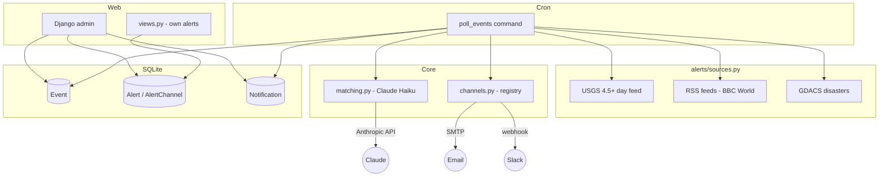
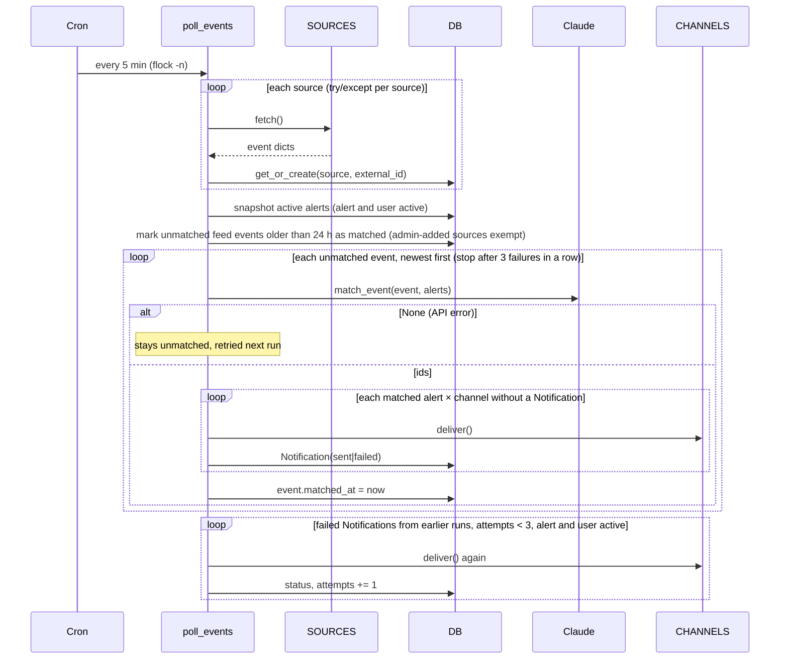
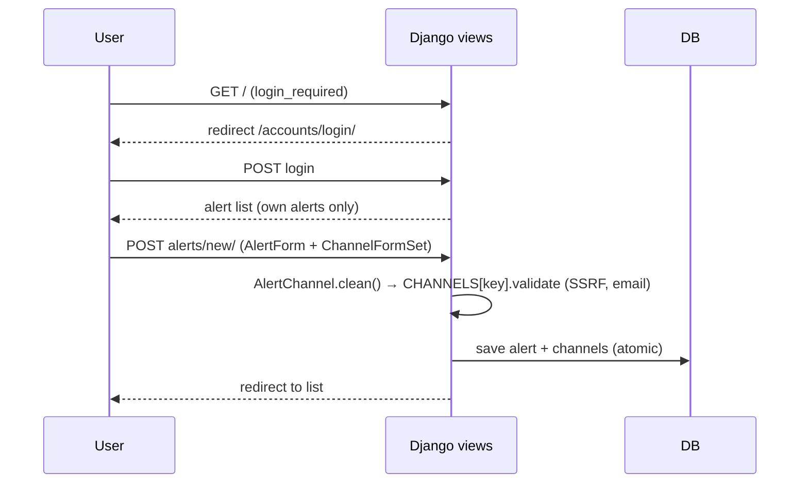

# Codebase Map

> Auto-generated by Cartographer. Last mapped: 2026-11-19T17:23:23Z

World event alerts: users write free-text alerts ("tell me if a big quake hits Japan"). A cron
command pulls events from free public feeds. One Claude Haiku call per new event decides which
alerts match. Matches are delivered by email or Slack webhook through a channel registry, and
each send is logged as a `Notification`. Admins manage everything in Django admin.

**Stack:** Python 3.12+, Django 6.1, SQLite, `anthropic` 2.10 (structured output via `pydantic`), uv.

## System Overview



## Directory Structure

```
.
├── manage.py                  # Django CLI
├── pyproject.toml / uv.lock   # deps: django>=6.1, anthropic, pydantic
├── README.md                  # setup, env vars, cron, extending
├── config/
│   ├── settings.py            # env-driven settings, MAILERS, feeds, model
│   ├── urls.py                # admin/, accounts/ (auth), "" (alerts)
│   └── asgi.py, wsgi.py
├── alerts/
│   ├── models.py              # Event, Alert, AlertChannel, Notification
│   ├── channels.py            # CHANNELS registry: email, slack (+ SSRF guard, escaping)
│   ├── sources.py             # SOURCES: usgs, rss, gdacs fetchers
│   ├── matching.py            # match_event(): one Claude call per event
│   ├── admin.py               # admin config (notification log read-only)
│   ├── forms.py, views.py, urls.py   # user alert CRUD
│   ├── management/commands/poll_events.py   # cron: ingest → match → send → retry
│   ├── migrations/0001_initial.py, 0002_notification_attempts.py
│   ├── templates/alerts/      # base, list, form, confirm delete
│   └── tests.py               # 53 tests, all network mocked
├── templates/registration/login.html
├── docs/                      # PROMPTS.md, VALIDATION-LOG.md (chat logs), this map
└── _bmad-output/implementation-artifacts/spec-world-event-alerts.md   # BMAD spec + review triage
```

## Module Guide

### Models (`alerts/models.py`)

```
User 1─* Alert 1─* AlertChannel 1─* Notification *─1 Event
Event:        UNIQUE(source, external_id)
Notification: UNIQUE(alert_channel, event)
```

| Model | Key fields | Notes |
|-------|-----------|-------|
| `Event` | `source`, `external_id`, `category` (news/market/disaster), `title`, `summary`, `url`, `occurred_at`, `matched_at` | `matched_at` null = still to match. `source` not in `SOURCES` (e.g. `manual`) = added in admin |
| `Alert` | `user`, `name`, `description` (free text), `active` | |
| `AlertChannel` | `alert`, `channel` (registry key), `target` | `clean()` delegates to `CHANNELS[channel].validate` |
| `Notification` | `alert_channel`, `event`, `status` (sent/failed), `attempts`, `error` | One row per channel per event |

All FKs cascade: deleting an alert or channel erases its notification history.

### Channels (`alerts/channels.py`)

**Purpose:** delivery extension point. `Channel(label, validate, send)` NamedTuple;
`CHANNELS = {"email": ..., "slack": ...}`.

- `send(target, subject, body)` raises on failure; `validate(target)` raises `ValidationError`.
- Slack SSRF guard: target must start with `https://hooks.slack.com/`. Checked in `clean()` and again in `send_slack`, which posts through `_opener` (redirects refused).
- `slack_escape` escapes `& < >` so feed text can't ping `<!channel>` or spoof links.
- Email: `send_mail(subject, body, None, [target])`, sender `DEFAULT_FROM_EMAIL`.

### Sources (`alerts/sources.py`)

**Purpose:** fetchers returning lists of `Event` field dicts (minus `source`).
`SOURCES = {"usgs": fetch_usgs, "rss": fetch_rss, "gdacs": fetch_gdacs}`.

- All HTTP via `_get(url)` (15 s timeout); tests patch it.
- `_rss_items` parses RSS 2.0 `<item>` only (Atom/RDF logs a warning). `external_id` = guid, else link.
- `fetch_rss` isolates failures per feed; `fetch_gdacs` drops `EQ*` guids (USGS covers quakes).
- No market feed: market events are added by hand in admin.

### Matcher (`alerts/matching.py`)

**Purpose:** `match_event(event, alerts) -> list[int] | None`. One `messages.parse` call with
all active alerts in one prompt, `output_format=MatchResult`, model `settings.ALERT_MATCH_MODEL`,
timeout 60 s.

| Outcome | Returns | Effect |
|---------|---------|--------|
| Any `anthropic.APIError` (400 included) | `None` | Event stays unmatched, retried next run |
| `pydantic.ValidationError`, refusal, `parsed_output is None` | `[]` | Event marked matched, nothing sent |
| Success | ids ∩ active alert ids | Foreign ids ignored |

Untrusted text (event title/summary/url, alert descriptions) is XML-escaped in the prompt.

### Poller (`alerts/management/commands/poll_events.py`)

**Entry point** for cron. Constants: `MAX_ATTEMPTS=3`, `MATCH_WINDOW=24h`, `MAX_MATCH_FAILURES=3`.
Helpers: `message(alert, event)` (subject with newlines collapsed), `deliver(ac, subject, body)`
(never raises; returns `(status, error)`).

### Web (`views.py`, `forms.py`, `urls.py`, templates)

- URL names: `alert_list` (`/`), `alert_create`, `alert_update`, `alert_delete`; auth under `/accounts/`.
- `alert_edit(request, pk=None)` serves create and update; `get_object_or_404(..., user=request.user)` → other users get 404.
- `AlertForm`: description capped at 2000 chars (it goes into every prompt); admin uses it too. `ChannelFormSet` (`BaseChannelFormSet`): inline, at least one channel (`min_num=1, validate_min=True`), prefix `channels`.

### Admin (`alerts/admin.py`)

`EventAdmin` (`matched_at` read-only), `AlertAdmin` (`form = AlertForm`) with channel inline (at least one channel), `NotificationAdmin`
view-only (no add/change/delete). Users are created here: there is no sign-up.

### Config (`config/settings.py`)

| Env var | Effect | Default |
|---------|--------|---------|
| `DJANGO_SECRET_KEY` | secret key | random per process |
| `DJANGO_DEBUG` | `1` only | off |
| `DJANGO_ALLOWED_HOSTS` | comma list, stripped | `localhost,127.0.0.1` |
| `DJANGO_CSRF_TRUSTED_ORIGINS` | comma list; needed behind an HTTPS proxy | empty |
| `EMAIL_HOST` | set → SMTP, unset → console backend | unset |
| `EMAIL_PORT` | blank → 587 | 587 |
| `EMAIL_HOST_USER` / `EMAIL_HOST_PASSWORD` | SMTP auth | empty |
| `EMAIL_USE_TLS` | `1`/`true`/`yes` | on |
| `DEFAULT_FROM_EMAIL` | sender | `alerts@localhost` |
| `ANTHROPIC_API_KEY` | read by the SDK | — |

Plain settings: `STATIC_ROOT` (`staticfiles/`, run `collectstatic` in production), `EVENT_RSS_FEEDS`, `ALERT_MATCH_MODEL` (`claude-haiku-5-5`), `MAILERS` (Django 6.1 style).

## Data Flow

### Poll run



### User flow



## Conventions

- Registries as dicts: `CHANNELS` (delivery), `SOURCES` (feeds). Extend by adding one entry.
- Failure isolation everywhere: per source, per RSS feed, per event, per send. Errors are logged, not raised.
- `deliver()` and `match_event()` return values instead of raising; `None` from the matcher means "retry later".
- Untrusted text is escaped at each output: XML in the prompt, Slack `& < >`, Django autoescape in templates.
- Known limits are marked in code with `# shortcut: <limit>, <when to upgrade>`.
- Settings come from env vars with safe defaults; Django 6.1 `MAILERS` instead of `EMAIL_BACKEND`.
- Tests: `PollTestBase` patches `alerts.channels._opener.open` (Slack); `claude_returning(ids)` / `claude_raising(exc)` patch the Anthropic client; `poll(sources_map)` swaps `SOURCES`; email uses `mail.outbox`. No network in tests.

## Gotchas

- **24 h window:** feed events (source in `SOURCES`) older than 24 h are marked matched without a Claude call or a send, with a warning count. Events from any other source (admin-added) always match. Matching runs newest first.
- **Retries ignore the matcher:** failed sends are retried even when the circuit breaker tripped. Retries skip inactive alerts and users, only cover notifications from the last 24 h, and go to the channel's *current* target.
- **Crash window:** `Notification` is created after `deliver()`, so a crash between them resends next run (`flock` only prevents overlap).
- **Description cap is form-level:** user form and admin enforce 2000 chars; direct ORM writes don't.
- **Choices from the registry:** adding a channel changes `AlertChannel.channel` choices, so run `makemigrations` (no schema change).
- **Alerts snapshot once per run:** an alert created mid-run waits for the next run. With no active alerts, new events are marked matched and never revisited.
- **400s retry:** a permanently rejected prompt stalls matching (an error logged each run, up to 3 calls per run) instead of dropping events.
- **Deployment:** set `DJANGO_CSRF_TRUSTED_ORIGINS` behind an HTTPS proxy and run `collectstatic`. Secure cookies and HSTS are not set.
- **`httpx2`** is imported by tests but only installed transitively via `anthropic`.
- `item.pop("external_id")` mutates source dicts: fetchers must return fresh dicts.

## Navigation Guide

**To add a delivery channel:** `alerts/channels.py` (validate + send + `CHANNELS` entry) → `uv run python manage.py makemigrations` → tests in `alerts/tests.py`, README "Adding a channel". No other file changes.

**To add an event source:** `alerts/sources.py` (fetcher returning `external_id`, `category`, `title` ≤500, `summary`, `url` ≤1000, tz-aware `occurred_at`; add to `SOURCES`) → tests patching `alerts.sources._get`. A new category needs `Event.CATEGORIES` + a migration.

**To change matching (model, prompt, error handling):** `alerts/matching.py`; model name in `config/settings.py` (`ALERT_MATCH_MODEL`); tests `PollTests` (`test_happy_path`, `test_prompt_escapes_untrusted_text`, error tests).

**To change polling rules (window, retries, breaker):** constants at the top of `alerts/management/commands/poll_events.py`; README "Polling".

**To change the user pages:** `alerts/views.py`, `alerts/forms.py`, `alerts/urls.py`, `alerts/templates/alerts/`; tests `AlertViewTests`.

**To change admin:** `alerts/admin.py`; tests `AdminTests`.

**To change config / env vars:** `config/settings.py` + README env table; `SettingsTests`.

**To see why something was built this way:** `_bmad-output/implementation-artifacts/spec-world-event-alerts.md` (intent, Spec Change Log, Review Triage Log).
