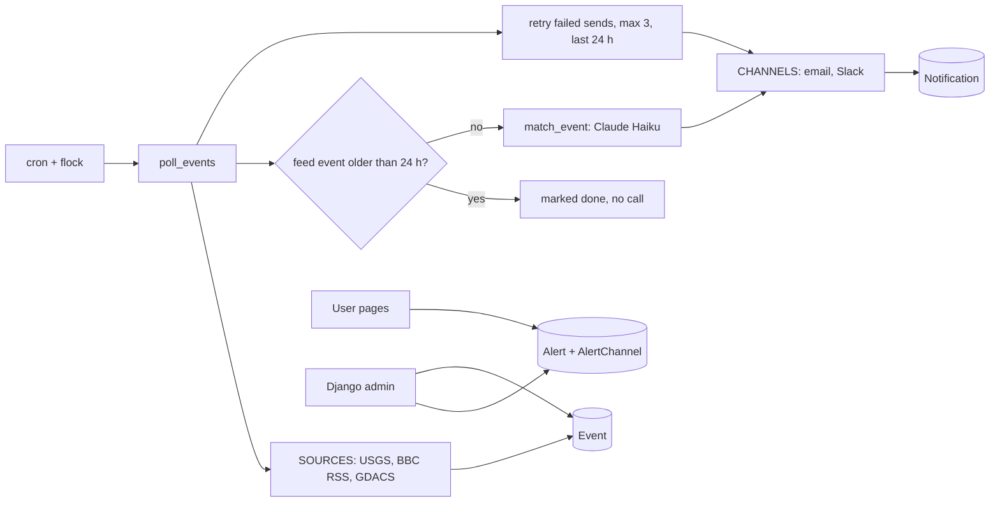

# Plan: World event alerts

Plan and status for the world event alerts app, taken from the BMAD spec
[`_bmad-output/implementation-artifacts/spec-world-event-alerts.md`](../_bmad-output/implementation-artifacts/spec-world-event-alerts.md).
The spec is the source of truth: it holds the full review triage logs, which are not repeated here.
This file merges the original plan with every later decision, so it describes the app as it is now.

**Status:** built and reviewed (4 review passes). Spec status `done`, no further review recommended.
54 tests pass. Last commit `20de65a`; `main` is 4 commits ahead of GitHub (not pushed).

## Goal

Users get notified when something important happens in the world (breaking news, market moves,
natural disasters), by email and Slack. More channels can be added later. Admins manage everything
in an admin view. The project started empty.

## Approach

A Django + SQLite app. A cron-run command (`poll_events`) polls free public feeds into `Event` rows.
For each new event, one Claude Haiku 5.5 call decides which users' free-text alerts it matches.
Matches are delivered through a channel registry (email, Slack incoming webhook) and logged as
`Notification` rows. Admins create users and manage everything in Django admin. Logged-in users
manage their own alerts on simple pages.

## Scope

**In:**
- Stack: Python 3.12+, Django 6.1, SQLite, `anthropic` SDK, managed with `uv`. No other runtime
  dependencies besides `pydantic` (used for structured output). Feeds and Slack use stdlib only.
- Free-text alerts ("tell me if a big quake hits Japan"), matched by `claude-haiku-5-5`: one call
  per new event covering all active alerts. Structured output returns the matched ids; ids not in the
  active set are ignored.
- Event text and alert descriptions are untrusted: the prompt says so, and both are XML-escaped.
- A channel registry: a new channel is one `Channel(label, validate, send)` entry, with no model or
  matcher changes beyond a choices migration.
- Slack targets must start with `https://hooks.slack.com/`. This is checked on save and again at
  send time, and redirects are refused (SSRF guard). Email targets must be valid addresses.
- An event is never notified twice to the same alert channel (a DB unique constraint plus a check
  before sending).
- One failing source, feed, channel send or event never aborts the poll run.
- Users only see and edit their own alerts. There is no public sign-up; admins create users.
- Config comes from the environment (see [Configuration](#configuration)).

**Out:** sign-up page, digests, custom admin dashboard, Slack OAuth app, Celery/queues, REST API,
paid feed APIs, frontend framework, a keyword/category pre-filter in front of the AI matcher, and
network calls in tests.

## Decisions

| # | Decision | Made by | When |
|---|----------|---------|------|
| 1 | Django + SQLite | Owner | Planning, round 1 |
| 2 | Free public feeds; admin can add events by hand | Owner | Planning, round 1 |
| 3 | Free-text alerts matched by AI | Owner | Planning, round 1 |
| 4 | Slack via an incoming webhook URL per alert | Owner | Planning, round 1 |
| 5 | Admin creates users (no sign-up) | Owner | Planning, round 2 |
| 6 | Stock Django admin as the admin view | Owner | Planning, round 2 |
| 7 | Claude Haiku 5.5 for matching | Owner | Planning, round 2 |
| 8 | Send immediately per matching event (no digest) | Owner | Planning, round 2 |
| 9 | Drop the market feed (Stooq was dead); market events are added by hand in admin | Owner | Review pass 1 |
| 10 | Auto-retry failed sends on later runs, at most 3 attempts | Owner | Review pass 1 |
| 11 | Add GDACS for non-earthquake disasters | Owner | Review pass 1 |
| 12 | Only feed events from the last 24 h are matched and sent; admin-added events always match | Owner | Review pass 3 |
| 13 | Every Anthropic API error, 400 included, leaves the event for the next run; 3 failures in a row stop matching for that run; alert descriptions capped at 2000 chars | Triage (not owner) | Review pass 3 |
| 14 | Slack recheck at send time, no redirects; admin uses the capped form; at least one channel per alert; `DJANGO_CSRF_TRUSTED_ORIGINS` and `STATIC_ROOT` | Owner ("Fix those!") | After pass 3 |
| 15 | Old feed events age out only for sources in `SOURCES`; newest first; retries only within 24 h; feed summaries stripped of HTML and capped | Triage | Review pass 4 |

The full question-and-answer record is in [`docs/PROMPTS.md`](PROMPTS.md).

## Architecture



The file-by-file guide is in [`docs/CODEBASE_MAP.md`](CODEBASE_MAP.md).

## Work items

All items are done.

| Item | Files | Status |
|------|-------|--------|
| Project skeleton, uv deps, env-driven settings, URLs | `pyproject.toml`, `uv.lock`, `manage.py`, `config/` | Done |
| Data model: `Event`, `Alert`, `AlertChannel`, `Notification` (+ `attempts`) | `alerts/models.py`, `alerts/migrations/` | Done |
| Channel registry: email, Slack (escaping, SSRF guard, no redirects) | `alerts/channels.py` | Done |
| Feeds: USGS 4.5+ day feed, RSS (BBC World), GDACS without earthquakes | `alerts/sources.py` | Done |
| AI matcher with error routing | `alerts/matching.py` | Done |
| Poll command: ingest, 24 h window, match loop with circuit breaker, retries | `alerts/management/commands/poll_events.py` | Done |
| Admin: events, alerts with channel inline, read-only notification log | `alerts/admin.py` | Done |
| User pages: list, create/edit, delete; login; one-channel minimum | `alerts/views.py`, `forms.py`, `urls.py`, templates | Done |
| Tests: every edge-case matrix row and every review fix (54 tests, network mocked) | `alerts/tests.py` | Done |
| Operator docs: setup, env vars, cron line, adding channels and sources | `README.md` | Done |

## Acceptance criteria

| Criterion | Status |
|-----------|--------|
| A superuser at `/admin/` can create users, alerts with channels, and events, and see the notification log filtered by status | Met (admin tests; the admin add-alert bug found by the review report is fixed in `20de65a`) |
| A user created by admin logs in at `/accounts/login/`, lands on their alert list, and can create an alert with an email and a Slack channel | Met (`test_login_lands_on_list_and_create_alert`) |
| `poll_events` with network mocked stores events and notifies matching alerts per the matrix | Met (`PollTests`) |
| A new `CHANNELS` entry appears as a choice in the alert form, with only a choices migration | Met by design (README documents the `makemigrations` step; no dedicated test) |

## Edge-case matrix

| Scenario | Input / state | Expected | Test |
|----------|---------------|----------|------|
| HAPPY_PATH | New USGS quake; active alert with email + Slack; matcher returns its id | 1 email, 1 Slack POST, 2 `sent` notifications, event matched | `test_happy_path` |
| DUPLICATE_FETCH | Same event fetched again | No new event, no new notifications | `test_duplicate_fetch` |
| FOREIGN_ID | Matcher returns an inactive or unknown id | Ignored | `test_foreign_ids_ignored` |
| CHANNEL_FAIL | Slack raises; email works | Email sent; Slack `failed` with error; run continues | `test_channel_fail` |
| CLAUDE_ERROR | Any Anthropic API error (500, connection, 400) | No notifications; event unmatched, retried next run | `test_claude_error_retries_next_run`, `test_bad_request_retried` |
| REFUSAL | Model refuses or output is unparseable | Event matched, nothing sent | `test_refusal`, `test_unparseable_output_not_retried` |
| SOURCE_FAIL | One source raises | Other sources still ingested and matched | `test_source_fail` |
| NO_ALERTS | No active alerts | No Claude call; events marked matched | `test_no_alerts_no_claude_call` |
| MANUAL_EVENT | Admin adds an event (any source name, any date) | Matched and delivered on the next run | `test_manual_event`, `test_old_admin_event_with_any_source_still_matched` |
| BAD_SLACK_URL | Slack target `http://evil.example/x` or a look-alike host | Form error, nothing saved | `test_bad_slack_url_rejected` |
| OTHER_USER | User A opens user B's alert | 404 | `test_other_users_alert_404` |
| OLD_EVENT | Feed event older than 24 h | Marked done, no Claude call, nothing sent | `test_old_events_marked_done_without_matching` |
| CLAUDE_DOWN | 3 failures in a row | Run stops matching; the rest waits | `test_stops_matching_after_repeated_claude_failures` |

## Configuration

| Variable | Purpose | Default |
|----------|---------|---------|
| `DJANGO_SECRET_KEY` | Secret key; set it in production | Random per process |
| `DJANGO_DEBUG` | `1` enables debug | Off |
| `DJANGO_ALLOWED_HOSTS` | Comma-separated hosts | `localhost,127.0.0.1` |
| `DJANGO_CSRF_TRUSTED_ORIGINS` | Comma-separated origins; needed behind an HTTPS proxy | Empty |
| `EMAIL_HOST`, `EMAIL_PORT`, `EMAIL_HOST_USER`, `EMAIL_HOST_PASSWORD`, `EMAIL_USE_TLS` | SMTP; without `EMAIL_HOST` mail goes to the console | Console, port 587, TLS on |
| `DEFAULT_FROM_EMAIL` | Sender | `alerts@localhost` |
| `ANTHROPIC_API_KEY` | Claude API key (read by the SDK) | — |

Plain settings: `EVENT_RSS_FEEDS`, `ALERT_MATCH_MODEL`, `STATIC_ROOT`. Cron line (from the README):

```
*/5 * * * * cd <dir> && flock -n ~/poll_events.lock uv run python manage.py poll_events >> ~/poll_events.log 2>&1
```

## Verification

```sh
uv run python manage.py check                          # no issues
uv run python manage.py makemigrations --check --dry-run   # no changes
uv run python manage.py test alerts                    # 54 tests pass
```

## Review history

| Pass | Findings | Patched | Outcome |
|------|----------|---------|---------|
| 1 | 49 (high 4) | 32 | Owner decisions: drop market feed, add GDACS, auto-retry |
| 2 | 54 (high 2) | 16 | Prompt escaping, inactive users, TLS setting fix |
| 3 | 70 (high 5) | 32 | Owner decision: 24 h window; every API error retries; circuit breaker; description cap |
| 4 | 41 (high 0) | 18 | Converged; admin channel minimum, feed hardening |
| Review report | 2 reader rounds | 1 bug | Admin "add alert" had no user field; fixed in `20de65a` |

## Open items and next steps

Decided or accepted, but still worth knowing:

1. **Never run against real services.** The Claude matching prompt, SMTP and Slack have only been
   exercised with mocks. Next step: one live run with a real `ANTHROPIC_API_KEY`, an SMTP server and a
   test Slack webhook.
2. **No market feed.** Market events come only from admin entry or as BBC news. A real feed (for
   example Finnhub with a free key) was offered and declined for now.
3. **Push.** 4 local commits are not on GitHub yet.
4. **Production hardening left out:** secure cookies, HSTS and an SSL redirect (they would break
   plain-HTTP setups), and a feed body size cap or `defusedxml` (the feeds are fixed, well-known
   publishers).
5. **Accepted limits:**
   - A crash between sending and recording a notification can resend it on the next run.
   - An admin event that Claude always rejects costs one failing call per run (no attempt cap; one
     would need a migration).
   - Updates to known events (GDACS escalations, USGS revisions) are not re-evaluated.
   - Duplicate channel rows (the same target twice) are allowed.
   - All active alerts go into one prompt; batch them when there are more than a few hundred.
6. **Spec detail:** the spec's admin task text lists the notification log without the `attempts`
   column; the code shows it.
